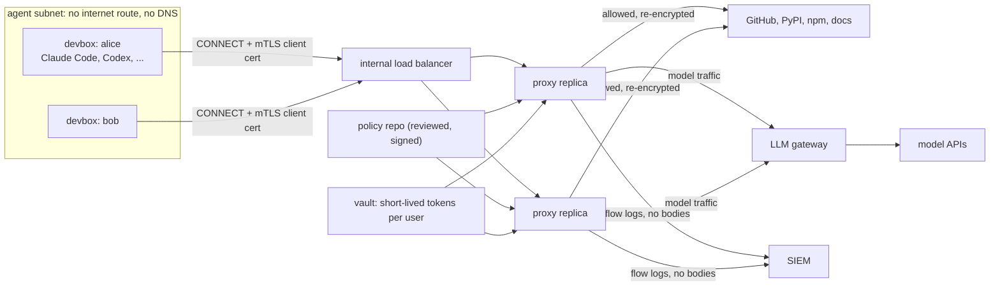

# Enterprise deployment guide

How to run this egress firewall for many developers and several coding agents. This repo is a
single-user prototype. Everything here marked **tested** was measured in this repo
([RESULTS.md](../RESULTS.md)). Everything else is design, or comes from vendor docs or user
reports, and says so. Doc checks were done on 2026-11-25; agent behavior changes often, so
re-check before you rely on a line here.

## 1. Enforce at the network, not in the agent's settings

The firewall only works if the proxy is the agent's **only** way out. A proxy setting the
agent can ignore, or that a user can change, is a suggestion, not a boundary:

- Claude Code reads `HTTPS_PROXY` from managed settings, but "when the session's launch
  environment already sets a variable, Claude Code ignores the settings file's value", and a
  developer who is an administrator on the machine can edit the managed settings file
  (code.claude.com/docs/en/network-config, /managed-settings).
- Node's built-in `fetch` ignores `HTTPS_PROXY` unless `NODE_USE_ENV_PROXY=1` (**tested**,
  [DECISIONS.md](DECISIONS.md#tools-that-ignored-proxy-or-ca-settings)).
- Users report that Cursor's agent skips its proxy setting while HTTP/2 is on, and that
  Antigravity's language server ignores the IDE's proxy settings (forum reports, section 6).
- MCP servers, hooks and helper processes run outside Claude Code's sandbox (docs, and
  **tested** in M3).

So the agent runs somewhere whose network has no route out except the proxy, and no DNS
resolver. In this repo that is a Docker network with `internal: true`: a process that ignores
the proxy fails closed (**tested**). In an enterprise, pick one of these:

| where the agent runs | how the proxy becomes the only way out | strength |
|---|---|---|
| **Cloud dev environment** (a VM or devbox in your VPC; Codespaces-style, Coder, plain VMs) | the subnet has no NAT or internet gateway and no DNS resolver; its only route is to the proxy's address | strong: the developer doesn't control the network |
| **Dev container on the laptop** (this repo's model) | container network with no route out; the proxy container sits on both networks | good against the agent; a laptop admin can still change Docker |
| **Native on the laptop** | endpoint firewall rules or a per-app VPN/SASE client that forces the agent's traffic to the proxy, ideally for a dedicated OS user that runs the agent | weakest: the user is often an admin, and attribution is per user, not per process. Not tested here |

Recommendation: run agents in cloud dev environments, with IDEs attached remotely, so the
boundary is outside the developer's control. Keep the laptop container setup for people who
can't use them.

Two things follow from "no route and no DNS":
- **DNS can't be used to exfiltrate**, because the agent can't resolve names; the proxy does.
- **The proxy must not become a route into your own network.** See SSRF in section 4.

### Steering with DNS instead of proxy settings

For agents that ignore proxy settings, DNS can do the steering: the agent's only resolver
answers every name the policy allows with the proxy's address, and nothing else; the proxy
accepts those connections in transparent mode. **Prototype, tested** in
[setups/proxy-dns](../setups/proxy-dns/README.md) with [dns-cache](https://github.com/s4steve/dns-cache):
Claude Code ran with no proxy variables, Node's built-in `fetch` (which ignores `HTTPS_PROXY`)
was caught, and replay leaked 0/33. Cursor and Antigravity were not tested in it.

A resolver that answers the agent reopens DNS as a way out unless it answers far less than a
normal one. The ways around it, and what closes each:

| bypass | what closes it |
|---|---|
| **Tunneling through the resolver**: `<encoded secret>.evil.com` reaches the attacker's name server via forwarding | Answer only from local records; never forward for the agent's view. Blocklists don't help (any unlisted name works), and neither do encrypted upstreams |
| **Allowed domains whose subdomains an attacker can delegate** | Exact names only, no "domain and all subdomains" allow rules |
| **Another resolver**: hard-coded 8.8.8.8, DoT, DoQ, DoH over 443 | No route except to the proxy and the resolver; keep DoH endpoints off the proxy's allowlist |
| **The client picks the IP**: connect to the attacker's address with an allowed SNI | The proxy connects to the name it judged, never to the address the client dialled. This is the new risk transparent mode brings; the prototype tests it |
| **ECH and HTTP/3 hints** in `HTTPS`/`SVCB` records | Records-only answers carry none; don't route UDP 443 |
| **Private or rebinding answers** | The agent only ever sees the proxy's address; the proxy still needs its SSRF check |
| **Spoofing another client's address** to land in a laxer view | Drop `NET_RAW` in the agent; keep agents alone in their address range |
| **The resolver as a second way out** | Run the agent's resolver with no route out at all: a records-only view needs no upstream |

Exact-name records mean every hostname a tool uses must be listed; a missing one breaks the
tool, it doesn't leak. Generate the records from the policy so the two can't drift.

## 2. One proxy per developer, or a central one?

Both work. What changes is where the CA key, the policy, the logs and the real tokens live.

| | per-developer sidecar (this repo) | central proxy fleet | hybrid |
|---|---|---|---|
| where it runs | next to each agent | a few replicas behind an internal load balancer | a sidecar next to each agent, plus a central control service |
| who the user is | implicit: one user per proxy | must be established per request (below) | implicit locally; the sidecar authenticates to the control service |
| CA signing key | one intermediate per developer; a leak affects one person | a few intermediates; a leak affects everyone | per developer, issued centrally, short-lived |
| policy | a file per machine | one policy, deployed once | pulled from the control service, signed |
| logs | scattered | one stream to your SIEM | shipped centrally |
| real tokens (broker) | on the developer's machine | in a vault; only the proxy reads them | fetched short-lived from the control service |
| latency | about +2 to 4 ms per request locally (**tested**) | adds a network hop, plus the same work | local |
| blast radius of a proxy bug | one developer | everyone | one developer |

**Recommendation:** a **central fleet** in front of cloud dev environments (they are already
in your network, the hop is short, and identity is easy). A **hybrid** for laptops: enforcement
stays local, while policy, logs and credentials come from one place.

### Telling users apart at a central proxy

Per-user policy (which GitHub orgs you may write to) and the broker (whose token to inject)
both need to know who is asking. Options, strongest first:

1. **mTLS from the dev environment to the proxy.** Each devbox gets a short-lived client
   certificate from your PKI; the proxy maps it to a user. Claude Code supports client
   certificates (`CLAUDE_CODE_CLIENT_CERT`, `CLAUDE_CODE_CLIENT_KEY`), but other tools in the
   same box (git, pip, curl) would each need their own setup. Terminating mTLS at a small
   local forwarder in the devbox, which every tool uses as its proxy, covers them all.
2. **Source address.** Each devbox has a fixed address in the agent subnet; the proxy looks
   the address up in your inventory. Simple, and as strong as your network's control of
   addresses.
3. **Proxy authentication** with a short-lived token from your identity provider, checked by
   an addon. Every tool must send it, which is the same problem as option 1.

The `process` label this repo logs (a proxy username) is **self-reported**: fine for
attribution in logs, never for authorization.

### Policy for many users

- Make `github_owners` per user or team: your GitHub orgs for everyone, plus the person's own
  account if you allow it. Keep "reads anywhere, writes only to owned repos".
- Replace the broker's `secret_file` with a vault lookup keyed by user. Prefer short-lived
  credentials, such as GitHub App installation tokens (they expire after an hour) scoped to
  your org's repos, over personal access tokens.
- Send model traffic through an LLM gateway (`ANTHROPIC_BASE_URL` for Claude Code) and give
  it `inspect: false` at the proxy, as today. The gateway is where prompts can be logged or
  checked; the proxy never sees inside them. Note that Claude Code's WebFetch still calls
  api.anthropic.com for a domain check unless `skipWebFetchPreflight` is set (docs).

## 3. Configure the agents anyway

The network is the boundary; managed settings narrow what the agent tries and remove
obvious gaps. For Claude Code (paths and keys from code.claude.com/docs, 2026-11-25):

- **Managed settings file**: macOS `/Library/Application Support/ClaudeCode/managed-settings.json`,
  Linux `/etc/claude-code/managed-settings.json`, Windows
  `C:\Program Files\ClaudeCode\managed-settings.json`. Users can't override managed keys
  (a local admin can edit the file).
- `env`: `HTTPS_PROXY`, `NO_PROXY`, `NODE_EXTRA_CA_CERTS` (or bake them into the dev
  environment image, which the user can't override as easily).
- `permissions.disableBypassPermissionsMode: "disable"`. This repo's harness uses bypass mode
  to test the network layer; real users shouldn't have it.
- **MCP**: `managed-mcp.json` (same directories) for an exclusive server list, or
  `allowedMcpServers` / `deniedMcpServers` with `allowManagedMcpServersOnly`. This matters
  because `claude -p` starts a repo's `.mcp.json` servers without asking (**tested**, M6).
  Note that `--strict-mcp-config` *replaces* the managed set rather than tightening it (docs).
- **Sandbox**: keep it on as a second layer for shell commands (`sandbox.enabled`), and lock
  its domains with `sandbox.network.allowManagedDomainsOnly`. It doesn't cover MCP servers,
  hooks or WebFetch, and it allows by domain only (**tested**, M1).

## 4. Securing the proxy itself

The proxy holds the keys to the kingdom: it can mint trusted certificates, it sees every
request in cleartext, and it injects real credentials. Treat it like an identity provider.

**The CA**
- Keep the root offline (HSM or an offline machine). The proxy only ever gets an intermediate.
  This repo already does that: the root key is never mounted.
- Make intermediates short-lived and rotate them automatically. One per region or per
  replica group, so a leak can be revoked without reissuing everything.
- Add **X.509 name constraints** to the intermediate, limited to the domains the policy
  allows. A stolen intermediate then can't impersonate your bank or your SSO. Most modern
  TLS clients enforce name constraints. Not tested here; test it with every agent you support.
- Trust the root **only inside agent environments** (dev environment images), never in
  laptops' system stores, and keep it separate from any corporate TLS-inspection CA.

**The process and the host**
- Run as a non-root user with a read-only filesystem, no shell, dropped capabilities and a
  seccomp profile. (This repo's proxy runs as root; fix that first.)
- Expose no admin interface. Use `mitmdump`, never `mitmweb`, and no remote control.
- Pin and patch mitmproxy. It parses hostile input (TLS, HTTP/1, HTTP/2, WebSocket) all day.
- Give the proxy hosts their own network segment. Their only outbound route is the
  internet (and the vault, the log pipeline and the policy source).

**SSRF: the proxy must not reach inside your network**
- Deny CONNECTs to private, loopback, link-local and metadata addresses (10/8, 172.16/12,
  192.168/16, 127/8, 169.254/16 including 169.254.169.254, fc00::/7, ::1).
- Check the **resolved IP**, not only the hostname, on every connection, so an allowlisted
  name that resolves to an internal address (DNS rebinding, split-horizon DNS) is refused.
  The current policy only checks names; this is the first code change for a central proxy.

**Policy**
- Keep the policy in git, reviewed by the security team (CODEOWNERS), and deployed signed.
  The proxy already keeps the last good policy if an edit is broken, and refuses to start on
  a bad one (fail closed).
- Exceptions are time-boxed rules added by pull request, with an owner and an expiry date.

**Availability**
- Several replicas behind a load balancer, with health checks. If every replica is down,
  agents have no network. That is the intended failure, but it needs on-call cover.

**Secrets**
- Broker tokens come from the vault, short-lived, held in memory, and never written to
  disk or logs. The proxy already logs credential names only and scrubs echoed tokens.

**Logs**
- One JSON line per flow, no bodies, secret-looking path segments redacted (as today). Ship
  them to the SIEM with append-only storage and a retention period your privacy review
  agrees to: URLs and hostnames reveal what people work on.
- Alert on: `broker_placeholder` hits (someone tried to send the placeholder elsewhere),
  secret detector hits, `policy_reload_failed`, spikes in `tls_failed_client` (a tool that
  rejects the CA, or one trying to pin), and denied writes to GitHub.

## 5. Rolling it out

1. **Observe** for two to four weeks per team. Every flow is logged with the decision
   enforce mode would make; nothing is blocked. This repo's `bin/daily.sh` does this for one
   developer. Count the would-deny flows by reason and destination: those are your false
   positives.
2. **Tune** the policy from that data: add destinations people really need, move noisy
   detectors (entropy was the noisy one here) to observe-only, and write the exceptions
   process down.
3. **Enforce** team by team. Watch the block rate and the help-desk queue for a week each.
4. **Broker** credentials last, once enforcement is stable: swap each team's GitHub tokens
   for placeholders, then other credentials one service at a time. AWS keys can't be brokered
   by a header swap (SigV4 signs with the key); use short-lived role credentials instead.

Track: false-positive rate per week, blocked attempts by reason, added latency at p50 and p95,
and the number of open exceptions.

## 6. Other agents

The proxy, its rules and its detectors don't care which agent sends the request. What does
vary by agent:

1. **Does it honor `HTTPS_PROXY`**, in every component (main process, language servers,
   terminals, child tools, MCP clients)? If any part doesn't, only the network layer saves you,
   and that part breaks until it is fixed.
2. **Which CA store does it trust?** Node (`NODE_EXTRA_CA_CERTS`), the OS store, Go's system
   roots, Python's certifi, a bundled store? The proxy root must be in each one it uses.
3. **Where does model traffic go?** Straight to a model API, or through the vendor's own
   backend? Give that destination `inspect: false` and accept the blind spot, or route it
   through a gateway you control.
4. **Does it pin certificates or need HTTP/2 or WebSockets** to its backend? Pinning can't be
   intercepted at all; that destination must be passed through uninspected (`SPLICE_HOSTS` in
   `egress.py`), which is a blind spot.
5. **Where do its tools run?** Locally, in a remote dev environment, or in the vendor's cloud?
   A vendor-cloud agent never touches your proxy.

For agents that ignore proxy settings, the DNS steering above is the fix to test first.

Run the agent behind the proxy in observe mode for a day and look for `tls_failed_client`
events and destinations you didn't expect. The DECISIONS.md tools table is the place to
record what you find.

| agent | proxy | CA | model traffic goes to | what to watch | source |
|---|---|---|---|---|---|
| **Claude Code** | `HTTPS_PROXY` honored, including WebFetch and its remote MCP client (**tested**); no SOCKS | `NODE_EXTRA_CA_CERTS` (**tested**); `CLAUDE_CODE_CERT_STORE` picks bundled and/or system roots | api.anthropic.com, or your gateway via `ANTHROPIC_BASE_URL` | shell exports beat managed `env`; MCP servers and hooks run outside its sandbox | this repo; code.claude.com/docs |
| **OpenAI Codex CLI** | sandboxed commands have no network by default (`sandbox_workspace_write.network_access`); `features.network_proxy` adds a domain allowlist and `allow_upstream_proxy` | not in the official pages read; community guides name `CODEX_CA_CERTIFICATE`, then `SSL_CERT_FILE` | OpenAI's API | its own domain allowlist has the same broad-domain problem as Claude Code's sandbox; `requirements.toml` lets admins constrain approval policies and MCP servers; Codex Cloud runs in OpenAI's environment, out of reach of this proxy | learn.chatgpt.com Codex docs; community guides |
| **Cursor** | VS Code-style `http.proxy`; users report the agent's model requests skip it while HTTP/2 is on (`cursor.general.disableHttp2: true` is the usual fix) | the OS trust store | Cursor's own backend (users' certificate errors name `api2.cursor.sh`), not the model vendor directly | a desktop app: on a laptop, only host-level enforcement catches it. With Remote-SSH to a devbox, the terminal and tools run behind the devbox's boundary but chat traffic still leaves from the laptop | Cursor forum reports, no official doc found |
| **Google Antigravity** | users report its Go language server ignores both the system and the IDE proxy settings; child tools (git, npm, curl) need `HTTPS_PROXY` set separately | OS trust store for the IDE; `NODE_EXTRA_CA_CERTS` for Node tools; x509 "unknown authority" errors when the CA is missing | Google's endpoints | no official proxy documentation found; only network-layer enforcement is reliable today; test after every update (reports of certificate errors starting in specific versions) | Google AI developer forum, community guides |

None of the last three were tested in this repo. Before supporting one, run it behind the
proxy in an observe-mode container, write down what bypassed the proxy or rejected the CA,
and add a row to the tools table in [DECISIONS.md](DECISIONS.md).

## 7. What this repo needs before production

In order of importance for a central deployment:

1. Deny private and metadata addresses, checking the resolved IP (SSRF).
2. Run the proxy as non-root, read-only, with no shell.
3. Per-request identity (mTLS or source address) and per-user policy.
4. A vault-backed broker with short-lived tokens.
5. Name-constrained, short-lived intermediates with automated rotation.
6. Log shipping and alerts.
7. Signed policy from a reviewed repo.
8. Known gaps from [RESULTS.md](../RESULTS.md#coverage-gaps): MCP over SSE, WebSockets,
   GitHub GraphQL, git push packs, and shapeless secrets through allowed writes.

## Sources

Checked 2026-11-25.
- dns-cache: [README](https://github.com/s4steve/dns-cache) at `b7c0ed9` (allowlists, walled-garden views, local records).
- Claude Code: [network configuration](https://code.claude.com/docs/en/network-config),
  [settings](https://code.claude.com/docs/en/settings),
  [managed settings](https://code.claude.com/docs/en/managed-settings),
  [managed MCP](https://code.claude.com/docs/en/managed-mcp),
  [permissions](https://code.claude.com/docs/en/permissions),
  [sandboxing](https://code.claude.com/docs/en/sandboxing).
- OpenAI Codex: [advanced configuration](https://developers.openai.com/codex/config-advanced),
  [agent approvals and security](https://developers.openai.com/codex/agent-approvals-security)
  (both now redirect to learn.chatgpt.com);
  community guides on [custom CAs](https://codex.danielvaughan.com/2026/05/08/codex-cli-tls-inspecting-proxies-custom-ca-certificates-enterprise/)
  and [proxies](https://codex.danielvaughan.com/2026/04/18/codex-cli-proxy-configuration-socks-http-corporate-networks/).
- Cursor (forum reports): [agent ignores http.proxy with HTTP/2](https://forum.cursor.com/t/agent-ignores-http-proxy-and-https-proxy-when-http-2-is-enabled-bypasses-corporate-proxy/173619),
  [self-signed certificate errors](https://forum.cursor.com/t/self-signed-certificate-error-breaks-cursor-ide-on-macos/170665),
  [api2.cursor.sh issuer certificate](https://forum.cursor.com/t/issuercertificate-api2-cursor-sh/137347).
- Google Antigravity (forum reports and community guides): [configuring the network proxy](https://discuss.ai.google.dev/t/how-do-i-configure-the-network-proxy/122941),
  [x509 errors by version](https://discuss.ai.google.dev/t/antigravity-2-5-5-fails-with-x509-cert-error-works-fine-on-2-1-1-windows-11-25h2/181702),
  [SSL errors since 2.18.1](https://discuss.ai.google.dev/t/ssl-certificate-error-since-antigravity-2-18-1-still-present-in-2-19-1/186729),
  [running behind a proxy](https://antigravitylab.net/en/articles/antigravity/antigravity-behind-proxy-connection-design).
